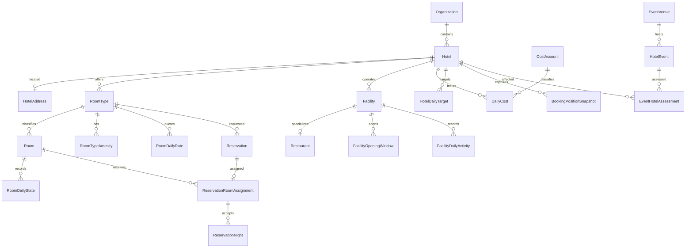

# Normalized hotel-network schema

`juyo` stores the canonical read-only fixture facts in relational tables. SQL Server reporting views reconstruct aggregate and presentation records; the separate backend exposes them through HTTP services to the local Angular frontend. Angular has no direct database connection. API-owned changes live separately in `juyo_api`.

The migration contains no transaction boundary. Its runner must execute schema creation, import and reconciliation in one transaction, with `XACT_ABORT ON`. The migration's indexed-view SET options must remain enabled for every connection that writes these tables.

## Ownership and grains

| Area | Base tables and grain |
| --- | --- |
| Organization and provenance | `Organization`; content-hash keyed `SourceImport`; ordered `SourceImportNote`; per-import reservation-status policy. |
| Geography | `Country`; one `City` per country/name; IANA `TimeZone`; `Hotel` belongs to one organization/city/time zone and owns its accounting currency; optional one-to-one `HotelAddress` stores only postal lines and postcode. |
| Rooms | `RoomType`; room-type/amenity bridge; physical `Room`; one `RoomDailyState` per room/date; one `RoomDailyRate` per room type/date. |
| Facilities | `Facility`; ordered daily opening windows, including overnight/24-hour windows; `Restaurant` as a one-to-one facility subtype; one activity row per facility/date. |
| Reservations | `Reservation` contains the accepted quote and requested room type; optional one-to-one `ReservationRoomAssignment`; one accepted `ReservationNight` per reservation/stay date. |
| Costs | `CostAccount` owns category/department/description; `DailyCost` owns dated hotel/account/basis amounts; `UnitCost` contains reference planning rates, separate from expenses. |
| Planning and booking positions | One `HotelDailyTarget` per hotel/date; `BookingPositionSnapshot` is keyed by hotel/stay date/capture date. |
| Events | `EventVenue` owns place and coordinates; `HotelEvent` owns dates/attendance; `EventHotelAssessment` associates a hotel with an event and captures assessment provenance and measured distance. |

Lookup tables hold the codes and labels used by each independent domain. `BookingChannel` additionally holds the source fixture's constant commission rate. `CalendarDate` covers the imported reporting dates and supplies dated-fact foreign keys. Reservation creation, arrival, departure, cancellation and snapshot capture dates are not constrained to that reporting calendar.

## Facts that are intentionally derived

- Room-type inventory is the count of physical rooms. It is not stored a second time.
- Room occupancy is out of service when the dated state says so, occupied when an accepted room night exists, and available otherwise. The current room snapshot joins the state on the import's business date.
- Reservation room revenue is the sum of its accepted nights. The full quote is nightly quote multiplied by stay length. Accepted nightly revenue can differ from later selling quotes; no database rule retroactively reprices a booking.
- Hotel daily occupancy/revenue, channel totals, restaurant/other revenue, monthly expenses, monthly channel performance and signed pickup are reporting calculations. Aggregates are not independently mutable base facts.
- Hotel and channel on a reservation night are reached through its reservation/requested room type. Hotel on a room is reached through its room type. Restaurant name, hotel, capacity and hours belong to its facility.

## Integrity boundaries

Every relationship has a foreign key with restrictive delete/update behavior. There are no cascading deletes. Monetary values use exact decimal columns, commission fractions use `decimal(9,6)`, coordinates use `decimal(9,6)`, business dates use `date`, and import timestamps use UTC `datetime2(3)`.

Two schemabound indexed join views enforce business uniqueness without redundant columns:

- `RoomNumberScope`: unique `(HotelId, Number)` across all room types.
- `RoomNightAllocation`: unique `(RoomId, StayDate)` across accepted reservations.

Set-based triggers validate reservation capacity, assigned/requested room-type agreement, accepted booking status, accepted stay dates, dated in-service inventory and restaurant subtype kind. Parent update/delete guards preserve the same rules in reverse. Housekeeping, maintenance and service availability remain independent: inspected rooms can be booked, and a reported minor repair need not remove a room from service. Maintenance notes are required when a maintenance issue is recorded. Full accepted-stay coverage is checked after import, since a reservation and all its nights are necessarily inserted in separate statements.

## Preserved fixture semantics

The current capture is 14 November 2026; the comparison is 7 November. The source provides 368 current hotel/day positions and 192 comparison positions for still-open stay dates. Comparison capacity was not supplied and stays NULL; it is not invented. Pickup is the difference between the two captures.

Cancelled reservations can retain their historical room assignment but have no accepted room-night rows. Pending and no-show rows also have no accepted nights. Local browser rate changes and operational overrides are not canonical read-only source facts and are not imported.

Event distance is a captured assessment measurement, retaining the source's Haversine calculation and centi-kilometre rounding. Replacing it with SQL Server geography distance would change the measurement method. Venue and hotel coordinates remain available for future map work.

The 2.3.0 postal addresses are explicitly sample data for the fictional hotels, not verified premises. They do not replace or geocode the illustrative coordinates. City and country remain normalized geography references rather than copied address fields. Public repair-provider lookups use only city/country and a fixed repair trade; private street addresses and room notes do not leave that search boundary. The additive address import preserves the 2.2.2 provenance capture and inserts a new current capture; readback comparisons use `CurrentSourceImport` and still compare every room, reservation and financial collection.

Facility windows use a sequence within the facility, `time(0)` endpoints and an explicit next-day flag. A 24-hour window is `00:00` to `00:00` with `EndsNextDay = 1`. No weekday schedule is invented when the source supplies only daily opening times.

Channel acquisition is rounded per hotel/channel/date before aggregation. The dated cost ledger already includes channel commission expenses; reporting must not subtract acquisition costs a second time. Planning unit costs are references and are not additional ledger expenses.
